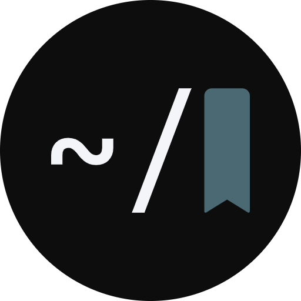

<!-- markdownlint-disable MD033 MD041 -->
<div align="right">
  
</div>

<div align="center">
  <a href="https://github.com/ananya-in-tech/tech-archive">
    
  </a>
  <a href="https://github.com/ananya-in-tech/tech-archive/blob/repo-revamp/CONTRIBUTING.md">
    
  </a>
  <a href="https://github.com/ananya-in-tech/tech-archive/discussions">
    
  </a>
  <a href="https://discord.gg/k34jbtruWB">
    
  </a>
</div>

<div align="center">
  <picture>
    <source media="(prefers-color-scheme: dark)" srcset="branding/banner-animated-ink.svg">
    <source media="(prefers-color-scheme: light)" srcset="branding/banner-animated-paper.svg">
    
  </picture>
  <p><strong>LEARN. DISCUSS. CREATE.</strong></p>
  <p>A community-driven library of technical knowledge, learning resources, and engineering references.</p>
</div>

---

## About Tech Archive

Tech Archive is an open, community-maintained knowledge library for engineering students and developers. It brings together structured notes, trusted learning resources, documentation, practice material, and career guidance across computer science and modern technology.

The goal is to help learners build strong fundamentals, explore technologies, become better engineers, and prepare for internships and software engineering roles across the industry.

## Explore the library

| Category | What you'll find |
| --- | --- |
| [Foundations](foundations/README.md) | Mathematics, discrete mathematics, probability, statistics, and computational thinking |
| [Programming](programming/README.md) | Programming languages, programming paradigms, and language fundamentals |
| [Computer Science](computer-science/README.md) | DSA, operating systems, networks, databases, OOP, and core CS subjects |
| [Software Development](software-development/README.md) | Web, mobile, desktop, game, and API development |
| [Emerging Technologies](emerging-technologies/README.md) | Artificial intelligence, machine learning, data science, cybersecurity, blockchain, and cloud |
| [Engineering Practices](engineering-practices/README.md) | System design, architecture, distributed systems, testing, DevOps, and engineering quality |
| [Interview Preparation](interview-preparation/README.md) | Coding interviews, technical rounds, machine coding, and interview experiences |
| [Career Resources](career-resources/README.md) | Resumes, internships, job search, open source, and professional communication |
| [Projects & Practice](projects-and-practice/README.md) | Project ideas, guided practice, case studies, and hands-on exercises |
| [Learning Roadmaps](learning-roadmaps/README.md) | Curated learning sequences for engineering domains and career goals |

## How resources are organized

Every subject owns its resources. Depending on the subject, a directory may contain:

| Directory | Purpose |
| --- | --- |
| `notes/` | Community-written Markdown notes and permitted study documents |
| `courses/` | Curated courses, lecture series, and tutorials |
| `books/` | Reading lists and legally redistributable material |
| `research-papers/` | Research papers, surveys, and publications |
| `practice/` | Exercises, problem sets, and practical work |
| `interview-questions/` | Subject-specific interview questions and explanations |
| `references/` | Official documentation and trusted external links |
| `assets/` | Supporting diagrams, images, datasets, and attachments |

These are conventions, not mandatory empty folders. Create only the directories that have useful content. Keep supporting assets close to the notes or subject that uses them.

## Repository map

```text
tech-archive/
├── foundations/
├── programming/
├── computer-science/
│   ├── data-structures-and-algorithms/
│   ├── operating-systems/
│   ├── computer-networks/
│   ├── database-management-systems/
│   └── object-oriented-programming/
├── software-development/
├── emerging-technologies/
├── engineering-practices/
├── interview-preparation/
├── career-resources/
├── projects-and-practice/
├── learning-roadmaps/
├── branding/                    # Project identity and visual assets
├── scripts/                     # Repository automation
├── .github/                     # Workflows, templates, and policies
├── CONTRIBUTING.md
├── LICENSE
└── README.md
```

Repository automation, GitHub configuration, and branding remain at the root because they support the project itself rather than one learning domain.

## Learning and interview preparation

Tech Archive is designed to support multiple learning goals:

- Build fundamentals in programming, mathematics, and computer science.
- Explore application development and emerging technology domains.
- Learn engineering practices such as testing, architecture, and system design.
- Practice data structures, algorithms, and technical interview questions.
- Prepare for internships and software engineering roles through technical and career resources.
- Learn collaboratively through community discussions and contributions.

The library is company-agnostic. It focuses on transferable engineering skills rather than claiming that any single resource guarantees a particular job or interview outcome.

## Community and discussions

Questions, suggestions, and study discussions are welcome in [GitHub Discussions](https://github.com/ananya-in-tech/tech-archive/discussions). The community spaces include:

- **Doubt Box:** Ask questions and get help understanding concepts or debugging solutions.
- **LeetCode Arena:** Discuss coding interview problems and approaches.
- **Codeforces Arena:** Share competitive programming editorials and strategies.
- **AtCoder Arena:** Discuss contest problems and solution approaches.
- **Tips & Tricks:** Share useful techniques, tools, and learning advice.
- **Showcase your Achievements:** Celebrate learning milestones and community contributions.

You can also join the [Tech Archive Discord community](https://discord.gg/k34jbtruWB).

## Contributing

Contributions are welcome, whether you are adding a high-quality course, writing a Markdown note, sharing a useful diagram, improving a roadmap, or correcting an outdated link.

Please read the [Contributing Guide](CONTRIBUTING.md) before opening a pull request. Prefer authoritative resources, describe why a resource is useful, credit original authors, and respect copyright and redistribution permissions.

## Project policies

- [Code of Conduct](.github/CODE_OF_CONDUCT.md)
- [Security Policy](.github/SECURITY.md)
- [Accessibility Statement](.github/ACCESSIBILITY.md)

---

<div align="center">
  <picture>
    <source media="(prefers-color-scheme: dark)" srcset="branding/icon-paper-512.png">
    <source media="(prefers-color-scheme: light)" srcset="branding/icon-ink-512.png">
    
  </picture>
  <p><em>Open knowledge. Shared progress. Better engineers, together.</em></p>
</div>
<!-- markdownlint-enable MD033 -->
