<!-- markdownlint-disable MD033 MD041 -->
<div align="right">
  
</div>

<br>

<div align="center">
  <a href="https://github.com/ananya-in-tech/tech-archive">
    
  </a>
  <a href="https://github.com/ananya-in-tech/tech-archive/blob/main/CONTRIBUTING.md">
    
  </a>
  <a href="https://github.com/ananya-in-tech/tech-archive/discussions">
    
  </a>
  <a href="https://discord.gg/k34jbtruWB">
    
  </a>
</div>

<br>

<div align="center">
  <picture>
    <source media="(prefers-color-scheme: dark)" srcset="branding/banner-animated-ink.svg">
    <source media="(prefers-color-scheme: light)" srcset="branding/banner-animated-paper.svg">
    
  </picture>
</div>

<br>

<!-- markdownlint-enable MD033 -->

<p align="center"></p>

## Community

Got questions, ideas, or want to showcase what you're building? Join our Discord community!

<a href="https://discord.gg/k34jbtruWB">
  <picture>
    <source media="(prefers-color-scheme: dark)" srcset="branding/animated/bubble/bubble-on-dark.svg">
    <source media="(prefers-color-scheme: light)" srcset="branding/animated/bubble/bubble-on-light.svg">
    
  </picture>
</a>

**[Join the server](https://discord.gg/k34jbtruWB)**

<p align="center"></p>

## A Note from the Developer

> Hey there! Thanks for stopping by. I created this repository to turn the often isolating (and sometimes exhausting) DSA grind into an interactive, automated, and collaborative space. Whether you are here to break down complex patterns, hunt down a stubborn bug, or find a study partner, you are incredibly welcome.
> 
> My only asks are simple: stay consistent, comment your code so others can learn from your logic, and lend a hand to your peers in the discussions. We are all engineering our growth one commit at a time. 
> 
> Happy coding! 🚀
> 
<!-- > — [**Ananya**](https://github.com/ananya-in-tech)
-->

<p align="center"></p>

## The Quick Dashboard

| Repository Core (The Vault) | Community Vision | Ecosystem Spaces (The Forum) |
| :--- | :--- | :--- |
| **Topic-wise Coding Notes** & insights | **Collaborate** on codes & deep logic | The Doubt Box & Tips & Tricks |
| **Curated Resources** & problem links | **Learn** core engineering patterns | LeetCode, Codeforces & AtCoder Arenas |
| **Multi-Language** crowd-sourced code | **Grow Together** through consistency | General Chat & Achievements |

<p align="center"></p>

## 📁 The Vault: Repository Structure

> Coming soon... (under build)
>

This repository avoids chaotic file dumps by organizing all code and resources into clean, **topic-wise folders**. This makes tracking progress and finding study materials completely frictionless.


```text
├── 01_Arrays/
│   ├── README.md              
│   └── Two_Sum/
│       └── ... and so on/
|       |
├── 02_Linked_Lists/
├── 03_Stacks_Queues/
|       |
|       |
|       ... and so on/
|       |
├── 09_Trees_Heaps/
└── 12_Dynamic_Programming/

```

### Inside Every Topic Folder:

* **The `README.md`:** Holds the conceptual breakdown of the pattern, curated problem lists (Striver/NeetCode), and hidden edge cases to look out for.
* **The Solutions:** Well-documented source files showcasing multiple optimal approaches to the exact same problem.

<p align="center"></p>

## The Forum: GitHub Discussions Guide

To prevent brilliant logic breakdowns, study notes, and debug logs from getting buried under endless message threads, our entire conversational layer lives right here in the **Discussions** tab.

> ### [🤘 Chit-Chat](https://github.com/ananya-in-tech/tech-archive/discussions/categories/chit-chat)
> 
> 
> *Catch up with the squad! Share tech news, programming memes, desktop workspace setups, or just introduce yourself to the community.*

> ### [❓ Doubt Box (Q&A Format)](https://github.com/ananya-in-tech/tech-archive/discussions/categories/doubt-box-q-a)
> 
> 
> *Stuck on an edge case, getting a TLE, or battling a segmentation fault? Paste your formatted code here and let’s debug it together. Once solved, the winning fix is pinned to the top for future readers.*

> ### [🗳️ Community Polls](https://github.com/ananya-in-tech/tech-archive/discussions/categories/community-polls)
> 
> 
> *Cast your vote! Help shape our coding schedules, choose next week’s DSA topics, or pick timings for group virtual contests.*

> ### [💻 LeetCode Arena](https://github.com/ananya-in-tech/tech-archive/discussions/categories/leetcode-arena)
> 
> 
> *Focused on interview preparation. Discuss the LeetCode Daily Challenge, ask queries about standard sheet patterns, or deep-dive into company-specific problem sets.*

> ### [⚔️ Codeforces Arena](https://github.com/ananya-in-tech/tech-archive/discussions/categories/codeforces-arena)
> 
> 
> *The Competitive Programming hub. Break down post-contest editorials, discuss Div 2/Div 3 speed strategies, and tackle math-heavy or advanced algorithms.*

> ### [🏯 AtCoder Arena](https://github.com/ananya-in-tech/tech-archive/discussions/categories/atcoder-arena)
>
>
> *Break down ABC, ARC and AGC problems. Compare approaches after the weekend contests, work through the classic math and DP tasks, and climb the colour ranks together.*

> ### [🏆 Showcase your Achievements](https://github.com/ananya-in-tech/tech-archive/discussions/categories/showcase-your-achievements)
> 
> 
> *The community hype zone! Celebrate your consistency streaks, LeetCode badge unlocks, Codeforces rank-ups, open-source merges, or job/internship offers.*


> ### [💡 Tips & Tricks](https://github.com/ananya-in-tech/tech-archive/discussions/categories/tips-tricks)
>
> 
> *Share your coding superpowers! Drop fast I/O shortcuts, C++ STL hacks, Python tricks, useful IDE extensions, or math shortcuts that save valuable seconds during contests and interviews.*

<p align="center"></p>

## 🤖 Discussions in LeetCode, Codeforces & AtCoder Arenas

This repository features automated helpers to fetch problem statements instantly! When starting a new discussion thread for a puzzle, follow these simple formatting steps to auto-generate a comprehensive briefing card:

### 1. LeetCode Arena Discussions
To start a study thread for a specific LeetCode problem:
* **Category:** Create a new discussion in the **LeetCode Arena** category.
* **Title:** Give the thread your own descriptive title (e.g., `Solving Two Sum using Maps`).
* **Body:** Simply paste the direct LeetCode problem URL in the body of the post.

### 2. Codeforces Arena Discussions
To start a study thread for a Codeforces problem:
* **Category:** Create a new discussion in the **Codeforces Arena** category.
* **Title:** Give the thread your own descriptive title.
* **Body:** In the body of the post, you can use either of these two simple formats:
  * **Option A:** Paste the direct Codeforces problem link in the body.
  * **Option B:** Type the contest parameters using this clean markdown format:

```markdown
# Contest ID
2074

# Problem Index
A

```

>There more other options for the markdown you can choose from just for the ease of your discussions.

```markdown
### Contest ID|# Contest ID|#contest|#contest id|# contest
2026

### Problem Index|# Problem Index|#problem|#problem index|# problem
A-Z

```

### 3. AtCoder Arena Discussions
To start a study thread for an AtCoder problem:
* **Category:** Create a new discussion in the **AtCoder Arena** category.
* **Title:** Give the thread your own descriptive title.
* **Body:** In the body of the post, you can use either of these two simple formats:
  * **Option A:** Paste the direct AtCoder problem link, such as `https://atcoder.jp/contests/abc300/tasks/abc300_a`.
  * **Option B:** Type the contest ID and problem index, using the same headings as the Codeforces Arena:

```markdown
# Contest ID
abc300

# Problem Index
A

```

The bot replies with the problem's name, contest, time and memory limits, score, and the full statement with samples, straight from AtCoder. AtCoder doesn't publish difficulty ratings, so the card shows the estimate from [AtCoder Problems](https://kenkoooo.com/atcoder/). Older problems that AtCoder only has in Japanese show the Japanese statement.

<p align="center"></p>

## Best Practices for Community Collaboration

To get the most out of every automated discussion thread, keep these simple habits in mind:

* **Keep Conversations in the Thread:** Avoid creating multiple separate discussions for the exact same problem number. If a thread already exists for a puzzle, open it up and add your approach as a reply comment inside that single master space.
* **Detail Your Complexity Math:** When sharing your solutions in the reply section, don't just paste code. Explicitly mention your performance targets using standard markdown strings (e.g., Time Complexity: `O(N)`, Auxiliary Space: `O(1)`).
* **Explain the "Why":** Break down your thought process. Did you use a sliding window because of a subarray constraint? Did you shift to a map optimization because lookups were hitting a time bottleneck? Teach your peers your algorithmic intuition!
* **Use Clean Syntax Highlighting & Forms:** When replying with code samples, always enforce proper language backticks so your snippets feature clean syntax highlighting. Additionally, utilize the automated templates inside the `.github/ISSUE_TEMPLATE/` directory when presenting formal blueprints or tracking bug fixes directly to the system project board.

<p align="center"></p>

## How to Collaborate

We must follow a clean, collaborative engineering workflow to make sure every line of code added to this repository meets high interview standards.

```text
[Pick Problem] ➔ [Write Solution & Notes] ➔ [Submit PR] ➔ [Peer Code Review] ➔ [Merge to Main]

```

1. **Keep it Sorted:** Add your problem solutions inside the appropriate topic folder. Please don't create unstructured files at the root level.
2. **Code Reviews:** When pushing a new approach, open a Pull Request. We use line-by-line comments to challenge time/space complexities and review variable naming readability.
3. **Use the Discussions:** If your code is failing hidden test cases, don't suffer in silence! Tag it with `status:bug-hunting` and drop it in **The Doubt Box** so someone can unblock you.

<p align="center"></p>

<div align="center">
  <picture>
    <source media="(prefers-color-scheme: dark)" srcset="branding/icon-paper-512.png">
    <source media="(prefers-color-scheme: light)" srcset="branding/icon-ink-512.png">
    
  </picture>
  <p><em>Built with passion for the open-source community. Let's stay consistent and build beautiful commit graphs together!</em></p>
</div>

